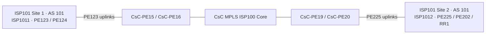

# ISP101 IPv4 page comparison

Compared `ISP101 IPv4` with `ISP101-v2 IPv4` in `005-CsC-MPLS-Lab-diagram.drawio`.

The second page preserves all 24 IPv4 links, including endpoint devices, interface labels, subnets, VLANs, and VRFs. All loopback and IS-IS NET label text is retained. It intentionally repeats P1–P6, eight switches, and their 32 physical links to separate the ISP1011 and ISP1012 logical views. Those repeated icons represent shared lab hardware, not additional physical devices.

## Corrections

- Both pages: corrected the P3–PE202 network label from `10.101.23.9/30` to `10.101.23.8/30`; endpoint addresses remain `.9` and `.10`. Updated the related base-interface documentation.
- Both pages: detached the P2–PE123 link from the P2 IS-IS annotation, retaining its explicit endpoint coordinates.
- Both pages: identified the cloud as `CsC MPLS ISP100 Core`.
- Second page: normalized `Site 2` title spacing.

## IPv4 link inventory

| Endpoint devices | Network | VLAN / VRF |
| --- | --- | --- |
| P6 ↔ P5 | 10.101.1.0/30 | VRF ISP1011 |
| P5 ↔ P1 | 10.101.1.4/30 | VRF ISP1011 |
| P5 ↔ P2 | 10.101.1.8/30 | VRF ISP1011 |
| P3 ↔ P6 | 10.101.1.12/30 | VRF ISP1011 |
| P4 ↔ P6 | 10.101.1.16/30 | VRF ISP1011 |
| P1 ↔ ISP101-PE225 | 10.101.21.0/30 | VLAN 225 SW29; VRF ISP1012 |
| P3 ↔ ISP101-PE225 | 10.101.23.0/30 | VLAN 225 SW212; VRF ISP1012 |
| P1 ↔ ISP101-PE123 | 10.101.11.0/30 | VLAN 123 SW27; VRF ISP1011 |
| CsC-PE15 ↔ ISP101-PE123 | 10.101.49.8/30 | VRF ISP101 |
| ISP101-PE123 ↔ CsC-PE16 | 10.101.49.12/30 | VRF ISP101 |
| P2 ↔ ISP101-PE123 | 10.101.12.0/30 | VLAN 123 SW28; VRF ISP1011 |
| P2 ↔ ISP101-PE124 | 10.101.12.8/30 | VLAN 124 SW214; VRF ISP1011 |
| P4 ↔ ISP101-PE124 | 10.101.14.0/30 | VLAN 124 SW213; VRF ISP1011 |
| P3 ↔ ISP101-PE202 | 10.101.23.8/30 | VLAN 202 SW211; VRF ISP1012 |
| ISP101-RR1 ↔ P3 | 10.101.23.4/30 | VLAN 231 SW211; VRF ISP1012 |
| P4 ↔ ISP101-RR1 | 10.101.24.4/30 | VLAN 231 SW210; VRF ISP1012 |
| ISP101-PE202 ↔ P4 | 10.101.24.0/30 | VLAN 202 SW210; VRF ISP1012 |
| ISP101-PE225 ↔ CsC-PE19 | 10.101.49.0/30 | VRF ISP101 |
| ISP101-PE225 ↔ CsC-PE20 | 10.101.49.4/30 | VRF ISP101 |
| P6 ↔ P5 | 10.101.2.0/30 | VRF ISP1012 |
| P3 ↔ P6 | 10.101.2.12/30 | VRF ISP1012 |
| P4 ↔ P6 | 10.101.2.16/30 | VRF ISP1012 |
| P5 ↔ P2 | 10.101.2.8/30 | VRF ISP1012 |
| P5 ↔ P1 | 10.101.2.4/30 | VRF ISP1012 |

## Verification scope

Parsed the draw.io XML, compared label inventories and link-associated labels, checked interface-label positions along each IPv4 link, and validated cell references. Most links use free coordinates rather than device attachments; endpoint identity was inferred from the closest device boundary. All original link signatures are present in v2; its extra links are the 32 repeated physical links described above. XML and whitespace checks passed. This is a structural comparison, not a rendered overlap review or validation against running router configurations.
