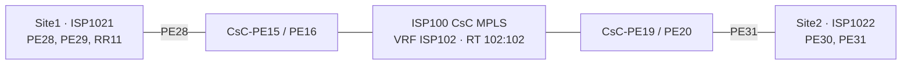

# ISP102 configuration and topology audit

Source: **ISP102 IPv4** in `005-CsC-MPLS-Lab-diagram.drawio`. Router configurations follow the existing ISP101 lab conventions, rebuilt for the updated ISP102 endpoints and Site1 RR11 placement.

## Corrections made to the ISP102 page

| Finding | Correction |
| --- | --- |
| Both site titles still showed BGP AS-101 | AS-102 |
| P-router and CsC loopback interfaces retained Lo1011 / Lo1012 | Lo1021 / Lo1022, avoiding collisions with ISP101 on shared routers |
| P4–PE29 link labeled VLAN 329 but P4 subinterface was Gi0/5.124 | Gi0/5.329 |
| PE31 repeated PE30's NET | PE31 now uses 49.0102.B000.0000.0031.00 |
| RR11 lacked loopback and NET labels | Assigned Loopback0 10.102.4.11/32 and NET 49.0102.C000.0000.0011.00, following the existing RR naming convention |
| PE31 used SW29 / SW212 Gi2/0, already assigned to ISP101-PE225 | Assigned Gi2/1 on each switch; saved switch configs show these ports without service configuration |

The new RR11 values and PE31 switch ports are design assignments added during this audit. They are not values observed on running equipment. Other diagram pages and ISP101 configurations were not changed by this task.

## Logical topology

P1–P6 are shared physical routers drawn twice to show isolated logical sites. Site1 uses Gi0/2.10 plus P5/P6 Gi0/6.10 and Gi0/10.10; Site2 uses corresponding .20 subinterfaces. PE/RR access VLANs are 311 and 328–331. CsC PEs use Gi0/14 in VRF ISP102.

## Files and application order

1. [001 — Base interfaces](001-ISP102-base-interface-configurations.md): P1–P6, four ISP102 PEs, RR11 and four CsC PEs; VRFs, loopbacks and all 24 routed links.
2. [007 — Switch VLAN transport](007-ISP102-switch-VLAN-transport.md): VLANs and local switch trunks for the new router subinterfaces.
3. [002 — IS-IS](002-ISP102-IGP-ISIS.md): two isolated site IGPs, unique NETs and passive loopbacks.
4. [003 — Site1 MPLS](003-ISP102-Site1-MPLS.md) and [004 — Site2 MPLS](004-ISP102-Site2-MPLS.md): per-context LDP and expected adjacencies.
5. [005 — CsC eBGP](005-ISP102-to-ISP100-CsC-eBGP.md): AS102/AS100 labeled exchange and restricted remote-loopback redistribution.
6. [006 — MP-BGP](006-ISP102-MP-BGP-VPNv4.md): RR11 with PE29 and PE30 as IPv4/VPNv4 clients.

## Design choices and boundaries

- Infrastructure RD/RTs are 102:1 and 102:2. Provider VRF ISP102 uses router-specific RDs and common RT 102:102. These follow the existing lab policy.
- IPv4, level-2 IS-IS with wide metrics, and LDP follow the existing router configuration style.
- RR11 is in Site1. PE28 exports its /32 across the CsC backbone along with both Site1 PE /32s. PE31 exports both Site2 PE /32s.
- Customer VRFs and addresses are not shown for ISP102; no ISP101 CUSTOMER-A configuration is copied. VPNv4 sessions alone do not create customer service routes.
- The existing ISP100 core IS-IS, LDP and VPNv4 sessions are prerequisites; these files add the ISP102 carrier VRF and eBGP neighbors.
- The saved EVE-NG `.unl` contains only ISP101 customer-carrier devices. It must be updated with ISP102 devices and cabling before these configurations can be exercised. This task does not alter the `.unl` or deploy configurations.

## Validation

Static checks cover all 24 /30 networks and 48 endpoint interface/address/VRF assignments, all 21 loopback addresses, 17 unique IS-IS NETs, site graph connectivity, matching VLAN tags, IS-IS/LDP interface coverage, and BGP peer/loopback references. Diagram XML and Markdown whitespace checks pass. No live IOS parser, adjacency, forwarding or rendered diagram overlap tests were performed. Verification commands are included in each configuration file.
